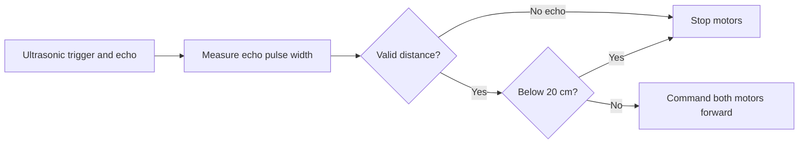

# Ultrasonic Obstacle Detection & Motor Stop Controller

An Arduino-based **reactive proximity-stop prototype** using an ultrasonic distance sensor and a two-channel motor driver.

> **Scope:** Although this repository was originally named *Obstacle-Avoiding-Robot*, the current software **detects an obstacle and stops the motors**. It does **not** steer around obstacles, plan routes, map an environment, or autonomously navigate. This distinction is important.

## System overview

- **Sensor:** HC-SR04-style ultrasonic trigger/echo interface (inferred from the pin usage; actual sensor model not documented).
- **Controller:** Arduino-compatible board with digital I/O and PWM support on pins 10 and 11.
- **Actuation:** Two motor channels via a suitable external H-bridge driver.
- **Behavior:** Move forward above the 20 cm threshold; stop below the threshold or when the refactored version receives no echo.

### Pin mapping from the original sketch

| Signal | Arduino pin | Purpose |
| --- | ---: | --- |
| TRIG | D2 | Ultrasonic trigger |
| ECHO | D3 | Ultrasonic echo input |
| IN1, IN2 | D4, D5 | Driver channel A direction |
| IN3, IN4 | D6, D7 | Driver channel B direction |
| ENA | D11 (PWM) | Channel A enable/speed |
| ENB | D10 (PWM) | Channel B enable/speed |

**Electrical caution:** Verify motor-driver logic levels, sensor echo voltage, motor supply ratings, common ground, and actual wiring before powering hardware. Do not power motors directly from Arduino I/O pins.

## Code

- [`firmware/ObstacleStopper/ObstacleStopper.ino`](firmware/ObstacleStopper/ObstacleStopper.ino) — **reviewed reference sketch**, adding an explicit sensor echo timeout and conservative motor stop on missing echo. **Not yet hardware-retested.**
- [`Obstacle-Avoiding Robot`](Obstacle-Avoiding%20Robot) — original October 2024 snapshot, preserved unchanged for provenance.

### Run it

1. Install Arduino IDE and select an Arduino-compatible board/port.
2. Verify the pin mapping against **your actual** sensor, driver, motors, and power distribution.
3. Open the file inside `firmware/ObstacleStopper/` as an Arduino sketch and upload it.
4. Open Serial Monitor at **9600 baud** to inspect reported distances and invalid echoes.
5. Test with the robot **raised so its wheels cannot propel it**, then perform controlled ground tests.

No third-party Arduino libraries are required by the reference sketch. Compatibility and physical behavior have not been verified on a particular board or motor-driver combination in this repository.

## How it works

1. Emit a 10 µs trigger pulse.
2. Measure the echo pulse width (`pulseIn`).
3. Estimate distance in centimetres using the approximate speed of sound.
4. If no echo is received within the timeout, stop the motors.
5. Otherwise, stop when distance is below 20 cm; command forward motion when it is 20 cm or more.

This is a simple baseline for learning sensor-to-actuator control, **not** a safety-rated collision-prevention system.

## Engineering limitations

- There is no obstacle-avoidance turn or recovery maneuver.
- Echo-based sensing is sensitive to material, angle, reflections, and sensor range.
- Threshold switching has no hysteresis or filtering; it may oscillate near 20 cm.
- Motor commands are open-loop; no wheel encoders or closed-loop speed control.
- Stopping distance depends on momentum, friction, speed, and mechanical design.
- The original sketch's `pulseIn()` has no explicit timeout; the reference sketch limits that wait.
- No build log, bill of materials, wiring photo, test video, or measured results have been published here yet.

## Validation

See [`docs/TEST_PLAN.md`](docs/TEST_PLAN.md) for proposed tests. **A test plan is not evidence that tests have passed.** Add measurements, board/driver models, photos and results only after executing the tests.

## Next engineering steps

1. Capture and document actual hardware, bill of materials and connections.
2. Measure detection repeatability and stopping distance at multiple approach speeds.
3. Add filtering, hysteresis and a motor-control watchdog.
4. Implement and evaluate a turning/replanning behavior if building a true obstacle-avoiding robot.

---

**Maintainer:** [Aamil Ali Saiyed](https://github.com/AamilAsaiyed) · Robotics & Automation Engineering undergraduate

**Project status:** Foundational embedded robotics prototype, with original code preserved and documentation being improved.
